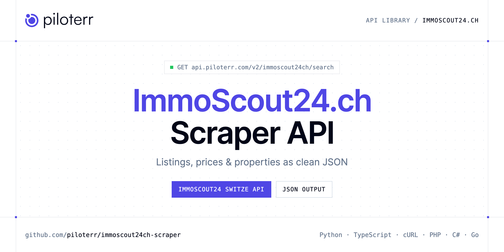

<p align="center">
  <a href="https://www.piloterr.com"></a>
</p>

# ImmoScout24.ch Scraper API

[](https://discord.gg/CFj3ph8aHU) [](https://app.piloterr.com) [](https://app.piloterr.com/openapi) [](LICENSE)

The **Piloterr ImmoScout24.ch Scraper API** lets you extract public data from ImmoScout24.ch as **clean, structured JSON** — no proxies, headless browsers or HTML parsing to maintain. Endpoints available in production:

- **ImmoScout24 Switzerland Search API** — Search ImmoScout24.ch listings by city or search URL and retrieve the CHF price, rooms, living area, and address.

Use it for property price monitoring, market analytics, investment sourcing or rental yield models.

| Endpoint | Path | Credits | What you get |
|---|---|---|---|
| [ImmoScout24 Switzerland Search API](#immoscout24-switzerland-search-api) | `/v2/immoscout24ch/search` | 2 | Search ImmoScout24.ch listings by city or search URL and retrieve the CHF price, rooms, living area, and address. Property pages are not available. |

## Table of contents

- [How it works](#how-it-works)
- [ImmoScout24 Switzerland Search API](#immoscout24-switzerland-search-api)
- [Code examples in other languages](#code-examples-in-other-languages)
- [Practical use cases](#practical-use-cases)
- [Why Piloterr?](#why-piloterr)
- [FAQ](#faq)
- [Related scrapers](#related-scrapers)
- [Support](#support)

## How it works

1. **Create a free Piloterr account** and copy your API key from the [dashboard](https://app.piloterr.com).
2. **Send a `GET` (or `POST`) request** to `https://api.piloterr.com/v2/...` with the header `x-api-key: YOUR_API_KEY`.
3. **Receive structured JSON** — Piloterr handles rendering, proxies, retries and parsing.

```bash
export PILOTERR_API_KEY="your-api-key"
pip install requests        # Python
# TypeScript: Node.js 18+ (native fetch), run with `npx tsx file.ts`
```

> Every endpoint accepts both `GET` (query string) and `POST` (JSON body with the same fields).

## ImmoScout24 Switzerland Search API

Search ImmoScout24.ch listings by city or search URL and retrieve the CHF price, rooms, living area, and address. Property pages are not available.

`GET | POST https://api.piloterr.com/v2/immoscout24ch/search` · **2 credits per request** · [Full reference](https://app.piloterr.com/openapi)

### Request parameters

| Parameter | Type | Required | Description |
|---|---|---|---|
| `query` | string | ✅ | Swiss city or a full ImmoScout24.ch search URL. |
| `offer_type` | string | — | rent or buy. |
| `property_type` | string | — | apartment, house, or all. |
| `page` | number | — | Page from 1. |
| `return_page_source` | boolean | — | Optional. Default false. |

### Python example

```python
import json
import os
import requests

response = requests.get(
    "https://api.piloterr.com/v2/immoscout24ch/search",
    headers={"x-api-key": os.environ["PILOTERR_API_KEY"]},
    params={
        "query": "zurich",
    },
    timeout=60,
)
response.raise_for_status()
data = response.json()

print(json.dumps(data, indent=2, ensure_ascii=False)[:2000])
```

### TypeScript example

```typescript
type Immoscout24SwitzerlandSearch = {
  results?: {
    id?: string;
    url?: string;
    floor?: unknown;
    price?: number;
    rooms?: number;
    title?: string;
    canton?: string;
    street?: string;
    currency?: string;
    features?: string[];
    latitude?: number;
    locality?: string;
    bathrooms?: number;
    image_url?: string;
    longitude?: number;
    price_net?: unknown;
    categories?: string[];
    created_at?: string;
    offer_type?: string;
    year_built?: number;
    description?: string;
    extra_costs?: unknown;
    postal_code?: string;
    living_space?: number;
    price_display?: string;
    [key: string]: unknown;
  }[];
  pagination?: {
    next?: string;
    page?: number;
    per_page?: number;
    total_pages?: number;
    total_results?: number;
  };
};

const params = new URLSearchParams({
  "query": "zurich",
});

const response = await fetch(`https://api.piloterr.com/v2/immoscout24ch/search?${params}`, {
  headers: { "x-api-key": process.env.PILOTERR_API_KEY! },
});
if (!response.ok) throw new Error(`Piloterr error ${response.status}: ${await response.text()}`);

const data = (await response.json()) as Immoscout24SwitzerlandSearch;

console.log(JSON.stringify(data, null, 2).slice(0, 2000));
```

<details>
<summary><b>POST variant</b></summary>

```http
POST https://api.piloterr.com/v2/immoscout24ch/search
x-api-key: YOUR_API_KEY
Content-Type: application/json

{"query": "zurich"}
```
</details>

### Output example

Example response from the API reference, abridged — real values depend on the page you scrape.

```json
{
  "results": [
    {
      "id": "4002086198",
      "url": "https://www.immoscout24.ch/mieten/4002086198",
      "floor": null,
      "price": 2257,
      "rooms": 1.5,
      "title": "City Pop - Cosy Studio Apartments just next to HB Zürich",
      "canton": "ZH",
      "street": "Militärstrasse 106",
      "currency": "CHF",
      "features": [
        "has_cable_tv",
        "has_dishwasher"
      ],
      "latitude": 47.375904371673,
      "locality": "Zürich",
      "bathrooms": 1,
      "image_url": "https://cdn.immoscout24.ch/listings/v2/e335city/4002086198/image/92c334cb2a581eeda57f107e6b2d3fd3.jpg",
      "longitude": 8.518085354726,
      "price_net": null,
      "categories": [
        "apartment",
        "flat"
      ],
      "created_at": "2025-04-07T14:53:38.768Z",
      "offer_type": "rent",
      "year_built": 2025,
      "description": "Wir bieten zentral gelegene Apartments im Gebäude City Pop Zurich City an der Militarstrasse 106, 8004 Zürich an, die zwischen 19 und 46 …",
      "extra_costs": null,
      "postal_code": "8004",
      "living_space": 24,
      "price_display": "CHF 2'257"
    }
  ],
  "pagination": {
    "next": "https://www.immoscout24.ch/de/wohnung/mieten/ort-zuerich?pn=2",
    "page": 1,
    "per_page": 20,
    "total_pages": 50,
    "total_results": 1222
  }
}
```

### Response fields

| Field | Type | Description |
|---|---|---|
| `results[]` | object[] |  |
| `results[].id` | string |  |
| `results[].url` | string |  |
| `results[].floor` | object |  |
| `results[].price` | integer |  |
| `results[].rooms` | number |  |
| `results[].title` | string |  |
| `results[].canton` | string |  |
| `results[].street` | string |  |
| `results[].currency` | string |  |
| `results[].features` | string[] |  |
| `results[].latitude` | number |  |
| `results[].locality` | string |  |
| `results[].bathrooms` | integer |  |
| `results[].image_url` | string |  |
| `results[].longitude` | number |  |
| `results[].price_net` | object |  |
| `results[].categories` | string[] |  |
| `results[].created_at` | string |  |
| `results[].offer_type` | string |  |
| `results[].year_built` | integer |  |
| `results[].description` | string |  |
| `results[].extra_costs` | object |  |
| `results[].postal_code` | string |  |
| `results[].living_space` | integer |  |

## Code examples in other languages

Ready-to-run examples live in the [`examples/`](examples) folder. Each one reads your key from the `PILOTERR_API_KEY` environment variable.

| Language | ImmoScout24 Switzerland Search |
|---|---|
| cURL (Bash) | [`search`](examples/curl/search.sh) |
| PHP | [`search`](examples/php/search.php) |
| C# | [`search`](examples/csharp/Search.cs) |
| Go | [`search`](examples/go/search.go) |
| Java | [`search`](examples/java/SearchExample.java) |
| Ruby | [`search`](examples/ruby/search.rb) |
| Node.js | [`search`](examples/nodejs/search.mjs) |

## Practical use cases

- **Price monitoring** — Track asking prices and price drops per area.
- **Market analytics** — Measure inventory, days on market and price per m² / sqft.
- **Investment sourcing** — Detect undervalued properties as soon as they are listed.
- **Rental yield models** — Combine sale and rent listings to estimate yields.
- **Proptech products** — Power portals, valuation tools and alerts with structured listings.

## Why Piloterr?

- **No infrastructure** — no proxies, headless browsers or CAPTCHA solving to run yourself.
- **Structured JSON** — stable, documented fields instead of brittle HTML selectors.
- **Pay per request** — transparent credit cost per endpoint, failed requests are retried for you.
- **One API key, hundreds of sources** — ImmoScout24.ch plus many other e-commerce, search and company data endpoints in the [Piloterr library](https://www.piloterr.com/library).
- **Any language** — plain HTTPS + JSON, with examples for Python, TypeScript, cURL, PHP, C#, Go, Java, Ruby and Node.js.

## FAQ

### Is it legal to scrape ImmoScout24.ch?

Collecting publicly available data is generally allowed in many jurisdictions, but rules depend on your country, the data you collect and how you use it. Avoid personal data unless you have a lawful basis, respect the website's terms where they apply, and get legal advice for your specific use case. This is not legal advice.

### Do I need proxies or a headless browser?

No. Piloterr handles rendering, proxy rotation and retries on its side. You only send an HTTPS request with your `x-api-key` header and receive JSON.

### How much does a request cost?

Credits per call: `/v2/immoscout24ch/search` **2**. See the [Piloterr website](https://www.piloterr.com) for plans.

### What data does the ImmoScout24.ch API return?

Each endpoint returns structured JSON: **ImmoScout24 Switzerland Search** — `results[]`, `results[].id`, `results[].url`, `results[].floor`, `results[].price`, `results[].rooms`.

### How do I paginate ImmoScout24.ch results?

Use the `page` parameter and keep requesting while the response indicates more results.

### Can I get the raw HTML instead of JSON?

Yes. Set `return_page_source=true` and the response becomes `{"result": "..."}` with the page source.

### Which languages are supported?

Any language that can make an HTTP request. This README shows Python and TypeScript; the [`examples/`](examples) folder contains cURL, PHP, C#, Go, Java, Ruby and Node.js.

## Related scrapers

- [Apartments Scraper API](https://github.com/piloterr/apartments-scraper)
- [Argenprop Scraper API](https://github.com/piloterr/argenprop-scraper)
- [Centris Scraper API](https://github.com/piloterr/centris-scraper)
- [Domain.com.au Scraper API](https://github.com/piloterr/domaincomau-scraper)
- [Fotocasa Scraper API](https://github.com/piloterr/fotocasa-scraper)
- [Funda Scraper API](https://github.com/piloterr/funda-scraper)
- [All Piloterr scrapers on GitHub](https://github.com/piloterr)

## Support

- 💬 Join the [Piloterr Discord](https://discord.gg/CFj3ph8aHU) to ask questions and share what you build.
- 📚 Browse the [API reference (OpenAPI)](https://app.piloterr.com/openapi) and the [Piloterr library](https://www.piloterr.com/library).
- 🔑 [Get your API key](https://app.piloterr.com).

---

<p align="center">
  <a href="https://www.piloterr.com">
    <picture>
      <source media="(prefers-color-scheme: dark)" srcset="images/logo-dark.svg">
      
    </picture>
  </a>
  <br>
  <sub>Built by <a href="https://www.piloterr.com">Piloterr</a> — web scraping APIs for e-commerce, search, real estate and more, one API key.</sub>
</p>

<sub>ImmoScout24.ch is a trademark of its respective owner. This repository is not affiliated with or endorsed by ImmoScout24.ch. Examples are released under the MIT license.</sub>
